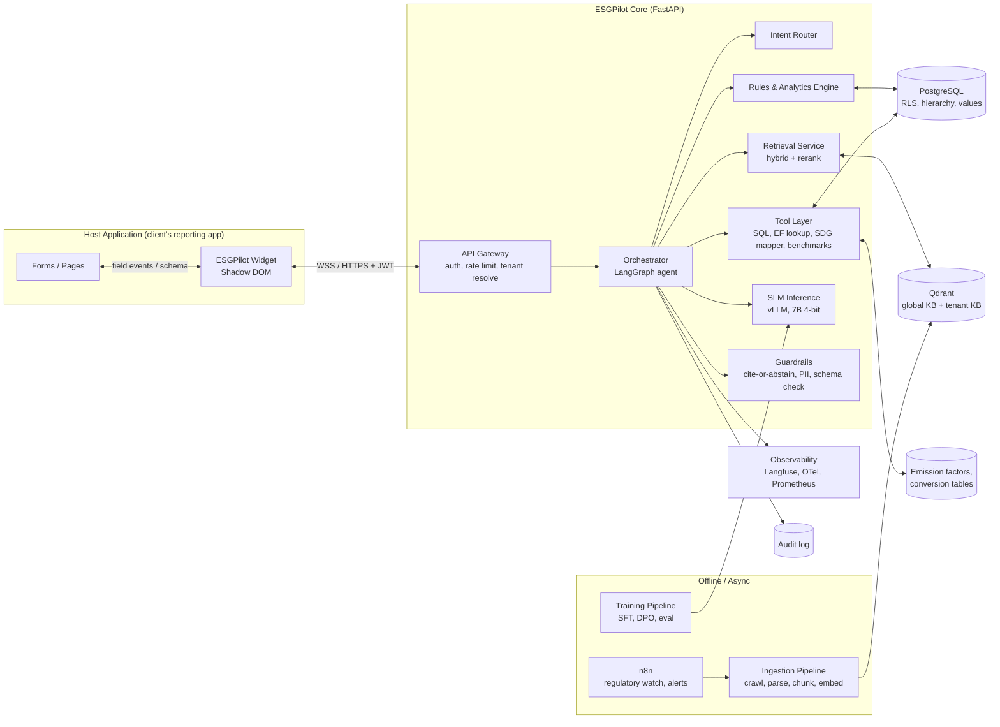
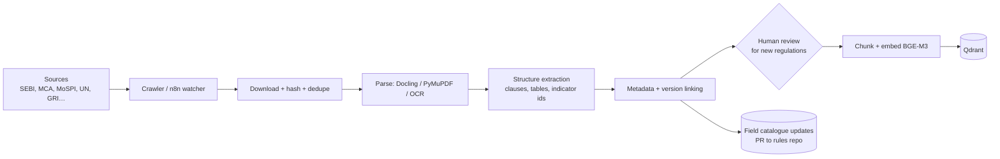
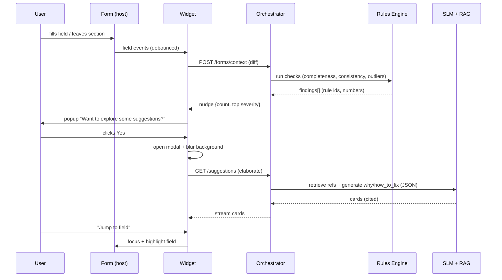

# ARCHITECTURE.md — ESG Copilot (ESGPilot)

## 1. System Overview



---

## 2. Components

### 2.1 Widget / SDK (frontend)
- **Tech**: TypeScript + Lit/Preact, Shadow DOM, bundled < 80 KB gz; chat panel lazy-loaded.
- **Modules**
  - `FormAdapter` – L1 schema push / L2 `data-esg-*` attributes / L3 auto-discovery.
  - `FieldObserver` – `MutationObserver` + `input/change/blur` listeners, debounced (400 ms), sends diffs only.
  - `NudgeManager` – decides when to show *"Want to explore some suggestions?"* (rate limits, mute, dedupe by suggestion id).
  - `OverlayController` – opens the panel on top layer, applies backdrop blur, focus trap, scroll lock, ESC handling.
  - `JumpToField` – scroll + highlight + focus host form field.
  - `Transport` – WSS with SSE/HTTP fallback, reconnect/backoff.
- **Blur implementation**: inject a fixed full-viewport overlay in Shadow DOM: `backdrop-filter: blur(8px) saturate(0.9); background: rgba(10,10,10,.35)`. Host DOM is untouched (no style mutation of host).

### 2.2 API Gateway
- Verifies tenant key / session JWT (issued by host backend via `POST /v1/sessions`, 15-min TTL, refresh).
- Resolves `tenant → entity → project → role` and attaches to request context.
- Origin allow-list (CORS + CSP guidance), per-tenant rate limits, request size caps.

### 2.3 Orchestrator (LangGraph)
Graph nodes:
1. **Context Builder** – merges form schema/values, user role, hierarchy position, framework selection, FY.
2. **Intent Router** – `field_help | section_review | kb_question | compare | nl_query | sdg_map | smalltalk`.
3. **Rules Node** – always runs first for form events (cheap, deterministic).
4. **Retrieve Node** – hybrid retrieval with metadata filters (framework, version, FY, tenant).
5. **Tool Node** – SQL analytics (allow-listed views), EF lookup, benchmark queries.
6. **Generate Node** – SLM writes explanation/recommendation using only provided evidence.
7. **Guard Node** – validates JSON schema, checks every claim has a citation or rule source, scrubs PII, abstains if evidence weak.
8. **Respond Node** – streams to client / stores suggestion objects.

> Nudge path (fast): Rules Node → (if findings) → emit nudge immediately → SLM elaboration only when user clicks *Yes*. This keeps the UI snappy and cuts GPU cost.

### 2.4 Rules & Analytics Engine (deterministic)
- **Field Catalogue**: machine-readable YAML/JSON of every BRSR field (Section A, B, C; Essential vs Leadership; Core KPIs), with `id, label, unit, type, mandatory_for, formula, validations, mapped_refs[GRI, SDG, NGRBC principle]`.
- **Check types**: completeness, type/unit, range, cross-field arithmetic (e.g., total = Σ parts), YoY delta, intensity plausibility, boundary consistency, evidence-attached.
- **Calculators**: Scope 1/2 (activity × factor), intensity ratios, energy conversions, water balance, waste totals — factors versioned by year/source.
- **Scoring**: framework readiness score = weighted completeness × validity × quality; breakdown always exposed (explainable).
- **Peer stats**: robust z-score/IQR/percentile within peer group; min sample guard (n ≥ 5 else fall back to sector benchmarks/YoY).
- Implemented as pure Python library (unit-tested, no LLM dependency) → reusable by batch jobs.

### 2.5 Retrieval Service (RAG)
- **Index layout** (Qdrant collections):
  - `kb_global` – public regulations/standards/guidance (all tenants).
  - `kb_tenant_{id}` – client policies, past reports, internal SOPs (private).
  - `kb_examples` – anonymised high-quality disclosure examples (for critique/benchmarking).
- **Chunking**: structure-aware (by clause/section/table), 300–600 tokens, parent-child (retrieve child, feed parent). Tables stored as markdown + row-level chunks.
- **Metadata per chunk**: `doc_id, doc_title, issuer, doc_type (law|circular|standard|guidance|example), version, effective_from, effective_to, superseded_by, section_path, framework, principle, indicator_id, page, url, lang, tenant_scope`.
- **Retrieval**: BGE-M3 dense + sparse → RRF fusion → `bge-reranker-v2-m3` top-k (e.g., 30→6) → **version filter** (prefer in-force docs for the report's FY).
- **Query rewriting**: SLM expands field/context into a standalone query (includes framework + indicator id when known) — improves recall on terse field labels.
- **Freshness**: each answer includes source `version/date`; superseded docs retained but down-weighted unless FY requires them.

### 2.6 SLM Inference
- **Serving**: vLLM, 4-bit AWQ 7B model, continuous batching, prefix caching (system prompt + framework context reused), JSON-mode/guided decoding for structured outputs.
- **Adapters**: base model + LoRA adapters hot-swappable: `reviewer`, `kb_qa`, `sdg_tagger`. Per-tenant adapters possible later.
- **Fallback**: CPU/llama.cpp build for on-prem small deployments (3B model, rules-first).
- **Escalation (optional, opt-in)**: route rare complex portfolio-reasoning prompts to a larger external model with redacted payload.

### 2.7 Guardrails
- **Cite-or-abstain**: generation must reference retrieved chunk ids or rule ids; post-check verifies cited ids exist and support claim (lightweight NLI/entailment check).
- **No-number policy**: any number in output must exist in the evidence payload; regex+set check, else regenerate/strip.
- **Scope policy**: only ESG/reporting topics; refuses legal-opinion or assurance claims; adds soft disclaimer on compliance-critical answers.
- **PII/secret filter** on inputs and logs.
- **Prompt-injection defence**: form values and uploaded docs treated as *data*, never instructions; delimiters + instruction-hierarchy system prompt; retrieved content sanitised.

### 2.8 Portfolio / Comparison Service
- Reads from **analytics views** (`v_metric_normalised`, `v_entity_scorecard`, `v_data_quality`) — never raw tables.
- **NL→SQL**: SLM emits a *query plan JSON* (metric, dimensions, filters, group_by, top_n, FY), a **validator** converts to parameterised SQL against allow-listed views with tenant + role predicates injected server-side. No free-form SQL from the model.
- Outputs chart specs (Vega-Lite JSON) + table + narrated insight.
- Scale: materialised views refreshed on report submit; move heavy aggregates to ClickHouse/DuckDB when > ~50M rows.

### 2.9 Ingestion Pipeline (offline)

- Every doc stored with SHA-256, source URL, retrieval date → provenance.
- Regulatory-change alerts: n8n compares hashes on key pages (SEBI circulars, MCA notifications) weekly → Slack/email to ESG SME for review.

### 2.10 Data Stores
| Store | Contents | Notes |
|---|---|---|
| PostgreSQL | tenants, users, roles, entities, projects, reports, field values, suggestions, feedback, audit | Row-Level Security by `tenant_id` (+ entity scoping) |
| Qdrant | embeddings + payload | Payload filter on `tenant_scope`, `framework`, `version` |
| Object storage (S3/MinIO) | raw docs, parsed JSON, evidence files, model artifacts | Encrypted, versioned |
| Redis | sessions, rate limits, debounce cache, job queue | |
| Warehouse (later) | historical metrics for portfolio analytics | ClickHouse/DuckDB |

### 2.11 Multi-Tenancy & Security
- **Isolation**: tenant_id on every row + RLS; separate Qdrant collection per tenant for private KB; per-tenant encryption keys optional (on-prem/VPC mode).
- **RBAC**: `project_user` (own project), `entity_admin` (subsidiary), `group_admin` (all entities), `auditor` (read-only + comments), `tenant_admin` (config).
- **Peer benchmarking privacy**: group admins can see named comparisons; project users see only anonymised percentile unless allowed.
- **Compliance**: DPDP Act 2023 (consent, purpose limitation, deletion), India data residency, audit trail, secrets in Vault/KMS, dependency scanning, pen-test before pilot.

### 2.12 Deployment
```mermaid
flowchart TB
  subgraph K8s["Kubernetes (cloud or client VPC)"]
    ING_[Ingress / WAF]
    API[api-gateway + orchestrator (HPA)]
    INF[inference (GPU node pool, vLLM)]
    RET[retrieval svc]
    RUL[rules svc]
    WRK[workers (ingestion, analytics refresh)]
    QD2[(Qdrant)]
    PG2[(Postgres HA)]
    RD[(Redis)]
    OB[Observability stack]
  end
  CDN[CDN: sdk.js + widget assets] --> Browser
  Browser --> ING_
```
- Modes: **SaaS multi-tenant**, **Dedicated tenant (VPC)**, **On-prem air-gapped** (rules + small SLM + local Qdrant; KB updates via signed bundles).
- Sizing starter: 1× GPU (24 GB) serves ~7B 4-bit for 100–200 concurrent light chats; 4 vCPU/16 GB for API; Qdrant 8 GB RAM for ~1–2M chunks.

---

## 3. Key Sequence Flows

### 3.1 Live form read → nudge → suggestion panel


### 3.2 Compliance doubt Q&A
1. User asks "Is Scope 3 mandatory in BRSR?" in Ask tab.
2. Router → `kb_question`; context adds company class + FY from session.
3. Query rewrite → hybrid retrieve (filters: framework=BRSR, effective for FY) → rerank.
4. SLM answers using chunks; Guard verifies citations; abstains if evidence insufficient.
5. UI shows answer + citation chips (doc, clause, version date) + "Last verified" badge.

### 3.3 Group comparison
1. Group admin: "Compare water intensity across my subsidiaries in FY25."
2. Router → `compare`; SLM emits query-plan JSON.
3. Validator maps to `v_metric_normalised` with tenant/role predicates.
4. Results + peer stats → SLM narrates (only numbers from result set) → chart spec rendered in Compare tab.

---

## 4. Data Schemas (core, simplified)

```sql
tenants(id, name, plan, region, settings jsonb)
entities(id, tenant_id, parent_id, name, cin, sector, size_band, state)
projects(id, entity_id, name, sector, location, start_date, status)
reports(id, project_id, fy, framework, status, submitted_at)
field_defs(id, framework, section, code, label, unit, type, mandatory_for jsonb, refs jsonb, version)
field_values(id, report_id, field_code, value_num, value_text, unit, source_type, evidence_url, entered_by, entered_at, verified_by)
suggestions(id, report_id, field_code, severity, payload jsonb, status, created_at, model_version, kb_version)
feedback(id, suggestion_id|message_id, rating, reason, user_id)
audit_log(id, tenant_id, actor, action, payload jsonb, ts)
kb_docs(id, title, issuer, type, version, effective_from, effective_to, url, sha256, scope, lang)
kb_chunks(id, doc_id, section_path, text, page, meta jsonb)  -- mirrored in Qdrant
emission_factors(id, source, year, region, fuel_or_grid, unit, factor, gwp_basis)
```

---

## 5. Observability & Ops
- **Tracing**: Langfuse per request: retrieved chunks, prompts, outputs, latencies, guard results.
- **Metrics**: nudge rate, accept rate, abstain rate, citation-fail rate, p95 latency, GPU util, tokens/s.
- **Alerts**: retrieval empty-rate spike, guard-fail spike, model drift on eval canaries (nightly gold-set run).
- **Release process**: model/KB/rules each versioned; canary to 5% tenants; automatic rollback if eval or guard-fail regresses.

## 6. Design Decisions (ADR summary)
| # | Decision | Why |
|---|---|---|
| 1 | SLM + RAG + rules, not a big LLM | Cost, latency, on-prem feasibility, controllability |
| 2 | Rules engine owns all numbers | Prevents hallucinated metrics; auditable |
| 3 | Knowledge in RAG, behaviour in fine-tune | Regulations change; weights shouldn't |
| 4 | Shadow DOM widget | Style isolation both ways |
| 5 | L1/L2 integration preferred over auto-scrape | Reliability and consent |
| 6 | NL→query-plan JSON, not raw SQL | Security, tenant isolation |
| 7 | Nudge from rules, elaborate on click | Latency + GPU cost |
| 8 | Qdrant hybrid search | Handles exact clause numbers *and* semantics |
