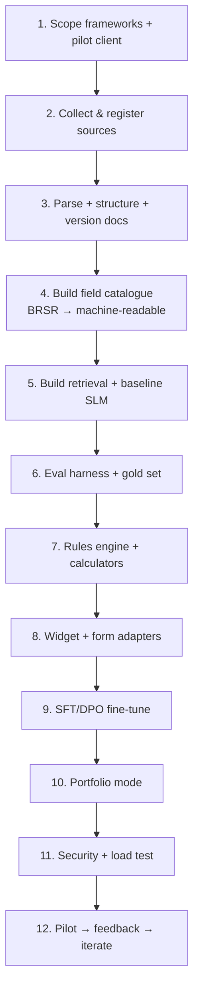
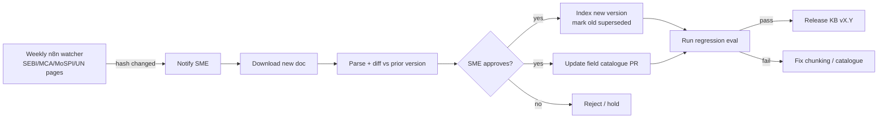
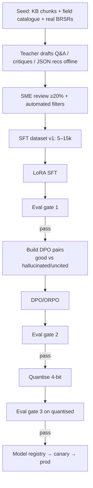
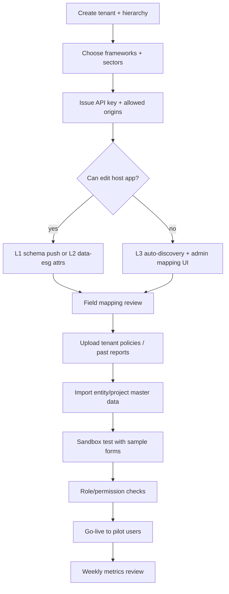

# WORKFLOW.md — ESG Copilot: Build, Data, Training & Run Workflows

Covers: (1) end-to-end build workflow, (2) data & KB pipeline, (3) training workflow, (4) runtime/user workflows, (5) integration onboarding, (6) maintenance & governance.

---

## 1. Master Build Workflow

### Step checklist

**1. Scope** – lock: frameworks for v1, pilot client, sectors, languages, deployment mode. (See BUILD_SPEC §13.)

**2. Sources** – use RESOURCES.md table A→C. Create KB register (§K). Download latest in-force docs; record hash + date + licence.

**3. Parse & structure**
- Docling/PyMuPDF → structured JSON (sections, tables).
- Detect clause/indicator IDs (regex + manual fixes), e.g. `P6-EI-7`.
- Link versions: `supersedes / superseded_by`.
- SME spot-check 10% of parsed docs (tables break most often).

**4. Field catalogue** (most important artifact)
- For each BRSR field: id, label, unit, type, mandatory flags, formula, validations, refs (GRI/SDG/NGRBC).
- Store as YAML in git, PR-reviewed by ESG SME. This feeds rules engine, form mapper, and retrieval filters.

**5. Retrieval + baseline**
- Chunk by clause; embed BGE-M3; index Qdrant; hybrid + rerank.
- Plug un-tuned SLM; get cite-or-abstain prompt working end-to-end.

**6. Eval first**
- Build gold sets: 300 clause-lookup Qs, 200 "form help" Qs, 100 out-of-scope/abstain, 50 narrative-critique samples, 50 SDG-tagging samples.
- Automate nightly run (RAGAS + custom checks). Track in a dashboard.

**7. Rules engine**
- Implement checks per field/section; unit tests with golden BRSR examples.
- Load emission factors (CEA, IPCC, DEFRA) with year/source versioning.

**8. Widget & adapters**
- Build SDK; L1 schema push first; then L2 data-attributes; L3 auto-discovery last.
- Nudge logic + blur modal + jump-to-field.

**9. Fine-tune** – see §3.

**10. Portfolio mode** – hierarchy, normalisation, peer groups, comparison API, NL→query-plan.

**11. Hardening** – RLS tests, pen test, prompt-injection tests, load test (200 concurrent), on-prem packaging.

**12. Pilot** – 1 group + 3 subsidiaries; weekly review of feedback, false-positive nudges, abstentions.

---

## 2. Data & Knowledge Pipeline Workflow

**Rules**
- No doc goes live without: provenance, version, effective dates, SME approval (for regulatory docs).
- Each KB release is tagged (`kb-2026.10.1`) and logged in answers ("KB as of …").
- Tenant-private uploads: virus scan → parse → tenant-only index → admin sees ingestion report.

---

## 3. Training Workflow

**Dataset buckets (target mix)**
| Bucket | Share | Example |
|---|---|---|
| Cited KB Q&A | 35% | "Which BRSR principle covers water withdrawal?" + clause cite |
| Form-field help | 20% | "What goes in 'Total energy consumed' and in what unit?" |
| Narrative critique / rewrite hints | 15% | Vague → specific, measurable disclosure |
| Recommendation JSON from rule findings | 15% | Findings in → structured card out |
| SDG tagging w/ rationale | 5% | Project description → SDG 6.4, 9.1 |
| Abstain / out-of-scope / injection | 10% | Unknown law, "ignore instructions…" |

**Eval gates** (must pass to promote): faithfulness ≥ 0.92, citation precision ≥ 95%, abstain ≥ 90%, JSON validity ≥ 99%, no regression > 2% on any bucket, SME blind review ≥ 85%.

**Hygiene**: split train/val/test by *document* (not by chunk) to prevent leakage; keep a frozen test set never used for training; log dataset + model hashes.

---

## 4. Runtime User Workflows

### 4.1 Data-entry employee (project level) — "form help"
1. Opens BRSR page → widget icon bottom-right.
2. Clicks into field *Scope 1 emissions* → hovers/asks "?" or opens chat: *"What do I enter here?"*
3. Bot: meaning, unit, how to compute from fuel records, which factor to use, citation.
4. User fills value → rules fire → if issue, nudge: *"Want to explore some suggestions?"*
5. Clicks **Yes** → background blurs, panel shows cards (why / how to fix / reference) → **Jump to field** → fix.
6. At section end, bot offers a **section review** (completeness + consistency).

### 4.2 Subsidiary ESG lead — "review before submit"
1. Opens full report → *Review* → readiness score + breakdown (rules-computed).
2. Prioritised gap list (impact × effort).
3. Compare project vs other projects in the entity / vs last FY.
4. Marks suggestions as accepted/ignored (feeds audit + feedback).

### 4.3 Group ESG head (MEIL-style, 200+ subsidiaries) — "portfolio"
1. Opens Compare tab.
2. Asks NL: *"Which subsidiaries have the highest GHG intensity in FY25 and incomplete waste data?"*
3. Query plan → validated SQL on allow-listed views → table + chart + narrative.
4. Drills down to project; sees best-practice peers; exports briefing.
5. Data-quality heatmap → send reminders to laggards (webhook/n8n).

### 4.4 Single company mode
Same flows; compare tab shows YoY + sector benchmark; verbosity toggle: **Brief / Detailed / Form-help only**.

### 4.5 Doubt-only usage (no form)
Employee opens bot → asks policy/compliance question → gets cited answer + "last verified" badge → can ask follow-ups or "show original clause".

---

## 5. Integration Onboarding Workflow (per client app)

**Go-live checklist**
- [ ] Origins whitelisted, CSP updated for `sdk.js`
- [ ] PII fields excluded/redacted
- [ ] Field mapping signed off (≥95% mapped)
- [ ] RBAC tested (project user cannot see other projects)
- [ ] Nudge frequency defaults agreed
- [ ] Support contact + feedback channel set
- [ ] DPDP consent/notice updated in host app

---

## 6. Maintenance & Governance Workflow

| Cadence | Task | Owner |
|---|---|---|
| Daily | Nightly eval canary on gold set; alert on drop | ML eng |
| Weekly | Regulatory watcher review; triage feedback 👎; false-positive nudge review | ESG SME + PM |
| Monthly | KB release; emission-factor update check; cost/latency review | ML + Platform |
| Quarterly | Model refresh decision (new SLM bake-off), re-run SFT/DPO if drift; security patching; access review | ML + Security |
| Annually (FY start) | Update BRSR catalogue for new FY rules, new CEA factors, new SDG data; re-baseline benchmarks | SME + Data |
| On regulation change | Fast-track: SME review → KB + catalogue update → regression eval → release within SLA (e.g., 5 working days) | SME + ML |

**Incident playbook (wrong/hallucinated answer reported)**
1. Capture trace (Langfuse) → classify: retrieval miss / stale KB / model error / guard miss / catalogue error.
2. Hotfix path: patch KB/catalogue or add guard rule; add case to eval set.
3. Root-cause: if model error → add to DPO negatives for next cycle.
4. Notify affected tenants if compliance-relevant.

---

## 7. Team & Roles (lean)

| Role | Count | Focus |
|---|---|---|
| ML/AI engineer | 1–2 | RAG, fine-tune, serving, eval |
| Backend engineer | 1 | FastAPI, hierarchy, analytics, security |
| Frontend/SDK engineer | 1 | Widget, adapters, UX |
| ESG/BRSR SME (consultant) | 0.5 | Catalogue, review, gold set |
| PM/Founder | 1 | Pilot, scope, client |
| DevOps (part-time) | 0.5 | K8s, GPU, observability |

---

## 8. First 2 Weeks — Concrete Task List

**Week 1**
- [ ] Freeze v1 scope (BRSR + BRSR Core + SDG + NGRBC + CSR s.135)
- [ ] Download & register docs A1–A3, B1–B5, C5, A9
- [ ] Repo setup: `/kb`, `/rules`, `/api`, `/sdk`, `/training`, `/eval`
- [ ] Parse BRSR format → draft field catalogue (Section A/B/C) in YAML
- [ ] Stand up Qdrant + BGE-M3 + a 7B model on vLLM/Ollama

**Week 2**
- [ ] Chunking with clause metadata; hybrid search + rerank
- [ ] Baseline cite-or-abstain Q&A endpoint
- [ ] Write first 150 gold Qs with SME
- [ ] Prototype widget: icon → nudge → blur modal (static data)
- [ ] First 10 rules (completeness + unit + YoY) with unit tests
